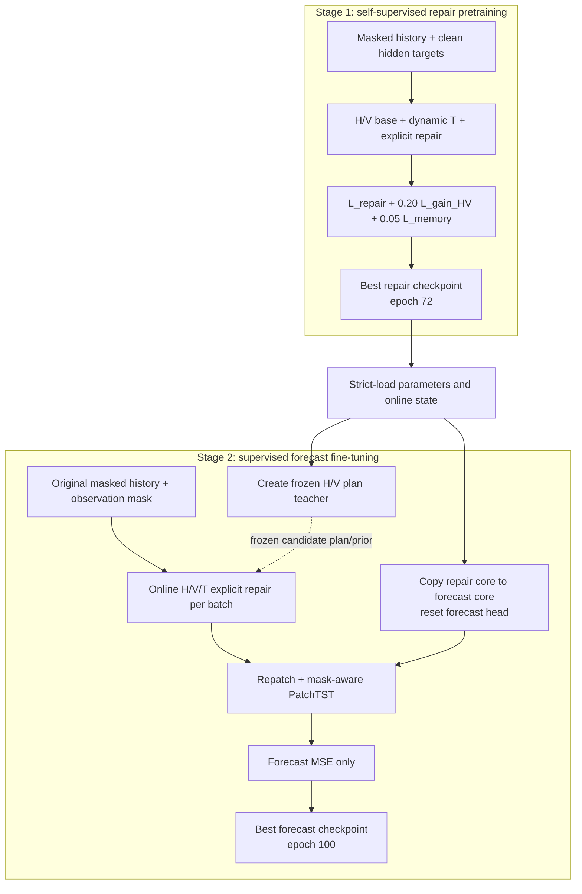

# E22 当前最优架构交接文档

状态：`CURRENT_PROTOCOL_BEST`  
标记日期：2026-09-16  
实验编号：E22  
架构简称：Dynamic Full-Lookback Temporal Repair  
用途：交给绘图 Agent 生成论文级系统架构图  

## 1. 使用边界

本文是 E22 已实现、已训练和已测试版本的架构事实源，不是下一版本的设想文档。

“当前最优”只表示它在以下固定 P4 协议下取得当前台账中最低的测试 MSE 和 MAE：

| 项目 | 固定值 |
|---|---|
| Dataset | ETTh1，7 variables |
| Lookback / prediction | `seq_len=96` / `pred_len=96` |
| Missing type | `variable_missing` |
| Missing parameters | `start_rate=0.10`，`block_len=8` |
| 实际测试缺失率 | `56.720430%` |
| Patch | `patch_len=16`，`stride=8`，end replication padding |
| Patch count | 11 patches / variable / window |
| Latent width | `d_model=16` |
| Seed | 2021 |
| Test mask SHA-256 | `f7974ff9b4228d69fe33d940e3722cd1a069766e2fa1387c6240757d5a8762d8` |
| Metric space | train-standardized |

该结论不等同于跨数据集、跨缺失协议或多随机种子的全局最优，也不构成统计显著性结论。

## 2. 一句话架构

E22 先用受保护的历史关系 H 和变量关系 V 形成 `{none,H,V}` 软融合基础恢复，再用独立的全回溯动态时序模块 T 根据当前窗口的局部锚点和远程上下文产生有界缺失残差，随后执行显式 overlap aggregation 与观测值硬覆盖，最后把恢复序列及其 observation mask 一起送入独立的 PatchTST 预测器。

主数据流必须画成：

```text
masked sequence + observation mask
        -> patchify / normalization
        -> H/V candidate relations + graph counterfactuals
        -> {none,H,V} soft fusion
        -> H/V base repair
        -> independent dynamic T residual
        -> explicit sequence repair + observed-value clamp
        -> repatch + mask projection
        -> independent PatchTST forecaster
        -> future prediction
```

## 3. 绘图交付要求

建议最终输出一张主图和一个训练阶段侧栏：

1. 主图展示一次前向推理的数据流，重点突出 H、V、T 的职责分工和 T 位于 H/V 之后。
2. 侧栏展示 Stage 1 自监督修复预训练与 Stage 2 预测微调的交接关系。
3. 用实线表示数值/latent 前向流，用虚线表示 teacher plan、mask 或训练监督，用锁图标表示冻结 teacher/online state。
4. 用不同颜色分组：H 蓝色、V 紫色、T 橙色、显式修复绿色、预测器深灰色、冻结模块浅灰色。
5. 图中应显示 `online repair per batch`，不能让读者误以为 Stage 2 读取离线修复数据。

推荐画布采用从左到右的五个大区：

```text
[Input & Patchify] -> [Protected H/V Base] -> [Independent Dynamic T]
                   -> [Explicit Repair] -> [Mask-aware PatchTST Forecast]
```

## 4. 符号与主要张量

| 符号 | 含义 | 主要形状 |
|---|---|---|
| `x_masked` | 原始窗口经过缺失后的输入 | `[B,96,7]` |
| `M_obs` | observation mask，1=真实观测，0=缺失 | `[B,96,7]` |
| `P` | query-normalized input patches | `[B,7,11,16]` |
| `M_patch` | patch 坐标 observation mask | `[B,7,11,16]` |
| `rho` | 每个 patch 的可见比例/可靠度 | `[B,7,11]` |
| `z_0` | repair patch projection | `[B,7,11,16]` |
| `z_HV` | `{none,H,V}` 软融合 latent | `[B,7,11,16]` |
| `x_HV` | H/V 基础恢复 patch | `[B,7,11,16]` |
| `delta_T` | 动态 T 的 missing-only 有界残差 | `[B,7,11,16]` |
| `x_repaired` | overlap 聚合、观测硬覆盖后的唯一恢复序列 | `[B,96,7]` |
| `y_hat` | 预测输出 | `[B,7,96]` |

图中不必把 batch 维展开，但建议在模块角标标注 `C=7, N=11, P=16, D=16`。

## 5. 主前向图

下面的 Mermaid 是结构草图，绘图 Agent 可以重排美化，但不能改变箭头语义。

```mermaid
flowchart LR
    X[Masked history x_masked] --> N[Query normalization]
    M[Observation mask M_obs] --> P[Patchify]
    N --> P
    P --> PV[Patch values and masks\nP, M_patch, rho]

    subgraph HV[Protected H/V base repair]
        W[Repair patch projection W_P] --> Z0[Base latent z_0]

        MEM[(Historical prototype memory)] -. retrieval .-> HC[H candidates]
        PV --> HC
        Z0 --> HO[Historical relation H]
        HC --> HO

        STAT[(Variable relation statistics)] -. prior .-> VC[V candidates]
        PV --> VC
        Z0 --> VO[Directed variable relation V]
        VC --> VO

        Z0 --> G[Branch-routed residual graph]
        HO --> G
        VO --> G
        G --> CF[none / H / V counterfactual latents]
        CF --> FUS[ForecastHVFusion\nsoft weights over none,H,V]
        PV -. missing geometry .-> FUS
        FUS --> ZHV[z_HV]
        ZHV --> DEC[Repair patch decoder]
        DEC --> XHV[x_HV]
    end

    PV --> W

    subgraph T[Independent dynamic temporal repair T]
        PV --> TC[All eligible same-variable\nnon-self source patches]
        TC --> SE[Source encoder\nobserved values + source mask]
        ZHV --> QE[Target query encoder]
        XHV --> QE
        SE --> SCORE[Content + geometry score\nwith log rho reliability bias]
        QE --> SCORE
        SCORE --> LC[Nearest reliable left/right\nlocal context]
        SCORE --> GC[All other eligible sources\nglobal full-lookback context]
        QE --> TG[none / local / global gate]
        LC --> TG
        GC --> TG
        TG --> RH[Shared residual head + tanh\nbound = 2 in normalized space]
        RH --> DT[delta_T\nmissing coordinates only]
    end

    XHV --> ADD[H/V base + T residual]
    DT --> ADD

    subgraph ER[Explicit provenance-preserving repair]
        ADD --> AGG[Overlap aggregation\npatches -> one length-96 sequence]
        PV -. validity and patch coordinates .-> AGG
        AGG --> CLAMP[Hard observed-value clamp]
        X -. original observed values .-> CLAMP
        M -. observed coordinates .-> CLAMP
        CLAMP --> XR[x_repaired]
        XR --> RP[Repatch with same length/stride]
        M --> RP
    end

    subgraph FC[Independent mask-aware PatchTST forecaster]
        RP --> FW[Forecast patch projection]
        RP -. recovered-coordinate mask .-> MP[Mask projection]
        FW --> SUM[Latent addition]
        MP --> SUM
        SUM --> ENC[PatchTST encoder]
        ENC --> HEAD[Forecast head]
        HEAD --> Y[Future prediction y_hat]
    end
```



## 6. H：历史原型关系

H 表示跨训练样本积累的历史模式，不是当前窗口内的普通时间邻居。

数据流：

```text
observed historical patches
    -> MaskAwareRetrievalEncoder
    -> RetrievalEncoderEMA / grouped online memory
    -> similarity filtering and historical top-k
    -> HistoricalRelationOperator
    -> historical message, gain, uncertainty and availability
```

必须表达的语义：

- H 的 memory 在 Stage 1 按既有在线协议积累；Stage 2 只读。
- H 的候选检索编码器与新 T 的 source encoder 是两套独立参数，不能画成共享编码器。
- H 在 Stage 2 仍通过学生 message path 服务预测；冻结 teacher 提供固定候选 plan 和 detached prior。
- H 的推理价值由 `without_H` 消融验证：移除 H 后 MSE 从 `0.443195` 上升到 `0.470573`。

## 7. V：有向变量关系

V 表示不同变量之间相对稳定的有向关系。它在同一窗口中为每个目标变量建立其他变量及其 patch 的候选池，并使用 source/target/lag 表示、translator、gain/uncertainty 和在线变量统计形成变量消息。

必须表达的语义：

- V 是跨变量路径，T 是同一变量内的时序路径；两者不能合并成一个 attention 框。
- V 的方向性是 `source variable -> target variable`。
- V statistics 在 Stage 1 积累，在 Stage 2 只读。
- V 与 H 可以同时获得非零融合权重，不是二选一 hard route。
- 移除 V 后 MSE 上升到 `0.502524`，说明 V 在 E22 中是有效组件。

## 8. H/V 基础软融合

H/V 模块先由 `BranchRoutedResidualRecovery` 构建 counterfactual route latents，再由 E21 延续下来的 `ForecastHVFusion` 对三条有效路径做软融合：

```text
z_HV = w_none * z_none + w_H * z_H + w_V * z_V
```

约束：

- `none` 始终可用，是关系候选不可靠时的安全退路。
- 不可用的 H 或 V 权重精确为 0。
- 有效权重在 `{none,H,V}` 上归一化为 1。
- H 与 V 可以同时贡献。
- 旧 T 在这个融合器里的权重保持精确为 0；E22 的新 T 位于融合器之后，因此不与 H/V 竞争这个权重。

## 9. T：独立动态全回溯时序修复

新 T 的实现类为 `DynamicTemporalContextRepair`。它不复用旧 `DynamicTemporalRelation` 的 gain/uncertainty/hard-route 语义。

### 9.1 候选源

对每个受损目标 patch，新 T 构造当前 96 点 lookback 内、同一变量、非自身的全部 patch 候选。当前有 11 个 patch，因此每个目标最多有 10 个源候选。

源候选必须：

- 至少包含一个有效观测坐标；
- 不使用 padding-only patch；
- 不把模型已生成的恢复值作为可靠源继续传播；
- 只来自 forecast origin 之前的 lookback，因此不存在未来标签泄漏。

源编码器输入是 `[observed_values * mask, mask]`。可靠度 `rho` 同时进入候选特征，并以 `log(rho)` 加到注意力 score 中。

### 9.2 Local / global 拆分

候选先根据 patch lag 与距离带识别 local 集合，再从目标左侧和右侧分别最多取一个最近可靠锚点。被选出的最多两个锚点形成 `local_context`。

其余所有 eligible source 形成 `global_context`。global 不是固定 top-k，也不限于近邻，因此它负责利用完整回溯窗口中的远程相关性。

local 和 global 分别执行 masked softmax，避免远程候选数量压制局部锚点。

### 9.3 动态门控与残差

T 根据 query、local context、global context 以及两者的 availability，在 `{none,local,global}` 上做动态 softmax：

```text
delta_T = 2 * [w_local * tanh(r_local) + w_global * tanh(r_global)]
```

- residual head 的最后一层零初始化，因此 T 在训练起点是严格 no-op。
- 残差在 query-normalized 空间限制到 `[-2,2]`。
- T 只能修改有效缺失坐标；观测坐标残差恒为 0。
- E22 测试时 global/local 使用率约为 `73.24% / 15.86%`。
- `without_T` 令该残差精确为 0；MSE 随后退化到 `0.498556`，这是新 T 有效的直接证据。

## 10. 显式恢复与 provenance

H/V 与 T 先产生 value-space patch 恢复，而不是把隐空间 latent 直接交给预测头。

由于 patch 重叠，一个时间坐标可能由多个 patch 覆盖。`build_explicit_repair` 执行：

1. 对有效 patch 坐标按绝对时间 scatter-add；
2. 除以 coverage，得到唯一长度 96 的恢复序列；
3. padding 不进入 numerator 或 coverage；
4. 所有原始观测坐标用真实观测值硬覆盖；
5. 用同一 `patch_len=16`、`stride=8` 重新切 patch；
6. 同时保留 observation mask，标记真实输入与模型恢复值。

这一过程可微，但观测坐标经过 hard clamp 后不会被预测损失改写。

## 11. Stage 1：自监督修复预训练

Stage 1 不执行未来预测。训练输入使用人为缺失的历史窗口，以 clean 历史坐标作为修复监督。

损失为：

```text
L_stage1 = L_repair + 0.20 * L_gain_HV + 0.05 * L_memory
```

其中：

- `L_repair`：在 overlap aggregation 后的唯一序列 missing coordinates 上计算 SmoothL1；这是唯一的数值重建损失。
- `L_gain_HV`：平衡回归 H/V 候选的反事实修复收益；不包含新 T。
- `L_memory`：H 检索 query/clean key 的 pair loss 与 batch-size 归一化 contrastive loss。
- 不使用 forecast loss、旧 route classification loss、单独 uncertainty loss或分支重复 reconstruction loss。

实现中的 repair core 只使用并训练 patch projection `W_P`；其 transformer encoder 与 forecast head 不参与 Stage 1 修复前向。H/V、graph、fusion、repair decoder 和新 T 由最终修复损失获得梯度，H/V gain 与 H retrieval 分别由辅助校准项训练。

Stage 1 结果：

| 字段 | 值 |
|---|---|
| Run ID | `ETTh1-ours-8dda1f69aa67` |
| Best epoch | 72 / 100 |
| Best validation MSE | `0.4516770331411734` |
| Best validation MAE | `0.4470300601939590` |
| Trainable parameters | 17,867 |
| Checkpoint | `artifacts/ETTh1/seq96_pred96/sr010_bl8/experiments/two_stage_v5_dynamic_temporal_context/checkpoints/ETTh1_ours_stage1.pt` |
| SHA-256 | `17dbf0c834d12149e5a12e5521a068c384f2f4cf9a8a335ae3e7b24e3cd522ab` |

## 12. Stage 1 到 Stage 2 的交接

Stage 2 strict-load Stage 1 best checkpoint 和 online state，然后：

1. 建立一个不可变的 Stage 1 H/V route teacher；
2. 复制 repair core，建立独立 forecast PatchTST；
3. 重置 forecast head；
4. 新建并零初始化 mask projection；
5. 新建 Stage 2 optimizer，epoch 从 1 重新计数。

注意：Stage 1 checkpoint 是参数与状态的初始化来源，不是预先导出的 restored dataset。Stage 2 每个 batch 都从原始 masked values 与 observation mask 重新在线生成 `x_repaired`。

## 13. Stage 2：预测监督微调

Stage 2 唯一损失是：

```text
L_stage2 = MSE(y_hat, y_true)
```

没有 repair、route、gain、uncertainty、memory 或 distillation 辅助损失。

### 13.1 有效训练路径

预测 MSE 更新：

- repair patch projection `W_P`；
- H/V 学生消息路径；
- graph recovery；
- `{none,H,V}` forecast fusion；
- repair patch decoder；
- 新动态 T；
- 独立 forecast PatchTST；
- mask projection。

冻结/只读：

- Stage 1 H/V route teacher；
- teacher 提供的 candidate plan 与 detached prior；
- historical memory、retrieval EMA、variable statistics 等 online state；
- 旧兼容 T 与旧 hard-route 诊断路径。

在 teacher-backed 前向中，学生 H/V gain/uncertainty 评分不决定 candidate plan；真正活动的是学生消息变换。架构图应强调“frozen plan/prior + trainable student messages”，而不是把完整 H/V 模块简单画成全冻结或全开放。

### 13.2 差分学习率

| 参数组 | 初始学习率 |
|---|---:|
| 独立 forecast PatchTST + mask projection | `1.0e-4` |
| 在线修复路径 | `2.5e-5` |

两组从 Stage 2 epoch 1 同时训练，保持 4:1 比例。

Stage 2 结果：

| 字段 | 值 |
|---|---|
| Run ID | `ETTh1-ours-dea387986927` |
| Best epoch | 100 / 100 |
| Best validation MSE | `0.7826386828000854` |
| Best validation MAE | `0.5960175909963595` |
| Trainable parameters | 51,710 |
| Checkpoint | `artifacts/ETTh1/seq96_pred96/sr010_bl8/experiments/two_stage_v5_dynamic_temporal_context/checkpoints/ETTh1_ours_stage2.pt` |
| SHA-256 | `9d96d5c74b72e6b3a5b517d59504ca73db3550a6d12181e4bf74ab084f103c24` |

## 14. 两阶段训练侧栏草图



## 15. 测试结果与组件证据

| 模型/消融 | Test MSE | Test MAE | 相对 full 的含义 |
|---|---:|---:|---|
| Clean baseline | 0.391587 | 0.406349 | 无缺失参考上界，不参与训练比较 |
| Missing baseline | 0.519669 | 0.466895 | 无修复缺失输入 |
| **E22 full** | **0.443195** | **0.433248** | 当前 P4 最优 |
| without H | 0.470573 | 0.447909 | H 有正贡献 |
| without T | 0.498556 | 0.459510 | 新 T 有显著正贡献 |
| without V | 0.502524 | 0.474723 | V 有正贡献 |
| H only | 0.514073 | 0.468811 | 单靠 H 不足，协同是关键 |

E22 相对 Missing：

- MSE 改善 `14.7159%`；
- MAE 改善 `7.2065%`；
- MSE-DRR `59.7069%`；
- MAE-DRR `55.5723%`。

E22 相对 E21：

- 测试 MSE 下降 `6.5709%`；
- 测试 MAE 下降 `5.1496%`。

## 16. 遗留字段与错误解读警告

E22 为保持旧 checkpoint、CLI 和诊断兼容，仍保留旧 T 与旧 hard-route 相关字段。绘图和论文描述必须以实际 E22 forward 为准：

- `route_temporal_rate=0` 指旧 hard route 没有选择旧 T，不代表新动态 T 未使用。
- manifest 中继承的 `stage2_temporal_forecast_weight=0` 描述的是 E21 H/V fusion 内的旧 T 权重；新动态 T 位于融合器之后，实际启用。
- manifest 中部分 `stage2_updates/stage2_frozen` 文本沿用 E21 标签；它们不是 E22 的完整 trainability 真值。
- evaluation 当前将新 T 的若干 `actual_gain` 兼容字段填为 0，不能把这些占位值画成“实际收益为零”。判断新 T 应使用 `without_T` 推理消融。

这些原始 manifest/evaluation 不应被回写修改，因为它们属于实验原始证据；本文负责解释其兼容语义。

## 17. 禁止画出的错误架构

绘图 Agent 不得采用以下画法：

1. 不要把 H、V、T 画成三选一 hard router。
2. 不要把新 T 画在 `{none,H,V}` soft fusion 之前或内部。
3. 不要把 H retrieval encoder 与 T source encoder画成共享权重。
4. 不要把 V 画成无方向的变量 self-attention；V 是有向 source-to-target 关系。
5. 不要把 Stage 1 输出画成一个离线 repaired dataset 再输入 Stage 2。
6. 不要省略 observation mask 到预测器的 mask projection。
7. 不要让 T 修改真实观测坐标。
8. 不要让 T 使用 forecast horizon 或模型生成的恢复值作为可靠 source。
9. 不要把 repair core 和 forecast PatchTST 画成完全同一个共享主干；Stage 2 中存在独立 forecast core。
10. 不要用旧 `route_temporal_rate=0` 推断 T 未启用。

## 18. 推荐图例

| 视觉编码 | 含义 |
|---|---|
| 蓝色模块 | Historical relation H |
| 紫色模块 | Directed variable relation V |
| 橙色模块 | Independent dynamic temporal T |
| 绿色模块 | Explicit value-space repair / provenance clamp |
| 深灰模块 | Forecast PatchTST |
| 浅灰 + 锁 | Frozen teacher / read-only online state |
| 实线箭头 | 数值或 latent 前向流 |
| 虚线箭头 | mask、candidate plan、prior 或监督信号 |
| `+` 圆节点 | 残差或 latent addition |
| 三角/softmax 节点 | 可学习软融合或动态门控 |

## 19. 实现文件索引

| 职责 | 文件 |
|---|---|
| E22 composition root、两阶段 trainability、损失 | `src/malr/models/dynamic_context_model.py` |
| 新全回溯动态 T | `src/malr/models/dynamic_temporal_context.py` |
| 显式 overlap aggregation、hard clamp、repatch | `src/malr/models/explicit_repair.py` |
| H/V/none 软融合 | `src/malr/models/forecast_fusion.py` |
| H relation | `src/malr/models/historical_relation.py` |
| V relation | `src/malr/models/variable_relation.py` |
| H memory / EMA | `src/malr/models/online_history.py` |
| T/V candidates and geometric features | `src/malr/models/candidates_v2.py` |
| counterfactual graph recovery | `src/malr/models/branch_recovery.py` |
| relation-v2 base and frozen teacher | `src/malr/models/online_stage1_v2.py` |
| Stage 1/2 optimizer groups | `src/malr/training/online_trainer.py` |
| CLI stage handoff and evaluation | `src/malr/cli.py` |
| E22 config | `configs/stage1_seq96_dynamic_temporal_repair.yaml` |

关键实现 SHA-256：

| 文件 | SHA-256 |
|---|---|
| `historical_relation.py` | `bd07747a11520f0e5dfec5e35752438058aef51f7a8977a2e49f45c9ebf89a6f` |
| `variable_relation.py` | `3e8c285f363ac479c0b4dcbe422080c526dbc1608f1d887596ebdac1dd780c6e` |
| `forecast_fusion.py` | `60b8ed23c8159fe1417df0c0afcc3c6999303e56d8ade4162db76fba751d6043` |
| `online_history.py` | `5e96b58abaf7a2a11c55c0412b43499307fb38fb966fed531ea1c71a2cc84468` |
| `candidates_v2.py` | `9369818d8aefafe9920e560e3d57e2cdc98e283f0e84862748022e49043a617f` |
| `branch_recovery.py` | `454db9cc1e20af3708b1ed7ad30bafb7faad807a2162c834f8128135208363c7` |
| `online_stage1_v2.py` | `93ecad9b8af21bd32a0cdadbf222fdb95a3c973bfb464e092488dcea393642f1` |
| `dynamic_temporal_context.py` | `8c458be2475ad129b3316524fe20906759eaee8e65579e520634025c70e7bf6b` |
| `explicit_repair.py` | `835606b293b05bf31645582d6c72659e9bf8e6ca9cdea724d0cd36040661cbb9` |
| `dynamic_context_model.py` | `0cdd5ede2dd4f44ccd6bb80a83f46fd6ea597eb8f59b1870a35c4a80d7f500df` |
| `online_trainer.py` | `fe902589e86ed2fc99ea147ad5de8fb566bbe9a0d5864430602750c89315a9a9` |
| `cli.py` | `de30645f31227c1c691abbcbdd73028ec2d572b3e7c97663fb3cd37b08c28b16` |
| E22 config | `6805b1c785e884411e85895104b927c815a75dea96d09a53728c916bcf61c9e5` |

## 20. 给绘图 Agent 的可复制任务说明

```text
请依据本文档绘制 E22 的论文级架构图。主图从左到右包含五区：
Input/Patchify、Protected H/V Base、Independent Dynamic T、Explicit Repair、
Mask-aware PatchTST Forecast。

必须突出：
1. H 与 V 先生成 none/H/V counterfactual latents，并进行可同时激活的软融合；
2. 新 T 独立位于 H/V 融合之后，使用 same-variable full-lookback sources，
   分成 nearest left/right local context 与 all-other global context，再通过
   none/local/global gate 输出 bounded missing-only residual；
3. overlap aggregation 后在序列级硬覆盖真实观测值，并重新切 patch；
4. observation mask 通过 mask projection 注入独立 forecast PatchTST；
5. Stage 1 是 repair pretraining，Stage 2 strict-load checkpoint 后逐 batch
   在线修复并只用 forecast MSE 微调；不是静态 repaired-data handoff；
6. frozen H/V teacher 只提供 candidate plan/prior，学生消息路径仍可训练。

请采用 H 蓝、V 紫、T 橙、显式修复绿、预测器深灰、冻结状态浅灰+锁。
不得把 H/V/T 画成三选一硬路由，也不得依据旧 route_temporal_rate=0
把新 T 省略。
```

## 21. 可追溯文件

- 当前最优机器可读指针：`artifacts/ETTh1/seq96_pred96/sr010_bl8/CURRENT_BEST.json`
- Stage 2 run manifest：`artifacts/ETTh1/seq96_pred96/sr010_bl8/experiments/two_stage_v5_dynamic_temporal_context/runs/ETTh1-ours-dea387986927.json`
- 正式测试结果：`artifacts/ETTh1/seq96_pred96/sr010_bl8/experiments/two_stage_v5_dynamic_temporal_context/evaluations/ETTh1-ours-dea387986927.json`
- 原始设计规格：`docs/superpowers/specs/2026-09-15-dynamic-full-lookback-temporal-repair-design.md`
- 实验总台账：`docs/experiments/ETTh1_experiment_ledger.md`

