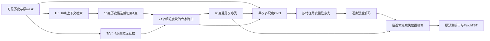

# CNN 与 Transformer 融入 E23 修复器的设计

日期：2026-10-04。状态：设计完成，尚未实现或启动训练。按用户本轮意见增加8/8、4/4修复粒度，并将H检索上下文与细粒度输出解耦。

目标：在原 H/V/T 恢复基础上，增加细粒度证据选择与输出，保留完整时间分辨率，通过共享时间卷积与按特征跨变量注意力改善历史修复，重点检查近期平均水平和趋势。预测器仍使用原 PatchTST 配置及训练接口。

## 1. 已核查的依据

- [T1 论文 §3](https://arxiv.org/html/2602.21043#S3)：共享多尺度时间卷积生成 Q/K/V，注意力沿变量轴运行，每个特征通道对应一个注意力头；其 head dimension 是时间轴长度。它与沿时间轴运行的普通多头注意力不同。
- 本地官方代码：`artifacts/upstream/T1/models/T1.py`，固定 revision `823b76aab57a2e60eb5029caab06fdfec8b19256`。`Attention.forward` 的 Q/K/V 为 `[B,H,M,T]`，SDPA 在 M 个变量之间运行。当前 ETTh1 作者脚本设置 128 通道、两阶段各两个 block、大核 71/31、小核 5。发布脚本的 mask embedding 为 false，不能把论文中的 mask embedding 描述当作当前基线已启用的配置。
- E23 v41 已有共享点级 CNN，宽度 64、两个 kernel5/dilation1 和 3 的残差块。此次不是首次引入 CNN。
- v38 曾用共享 kernel71/5 CNN 和按特征跨变量传递增强 T/V 的 patch 消息。Stage1 修复 MSE 由 v31-B 的 0.285927 降至 0.219032，但测试预测 MSE 为 0.408666，未超过对应 v31-B 的 0.408581。v39 再堆叠一层也未改善预测。不能将同类方案再次描述为尚未探索的直接收益。
- [当前 v41 诊断](ETTh1_P4_E23_v41_recovery_bottleneck_20261004.md)：最近32点均值与趋势的真实历史干预能降低固定预测器的验证 MSE；这提供方向，不保证可训练模块取得相同收益。

## 2. 接入位置：完整序列上的修复精修器

保留 H/V/T 的证据来源，调整T/V、路由和数值解码到细粒度；H仍用16点检索上下文。三专家首先给出唯一的96点粗修复序列，新的 CNN/Transformer 支路读取粗修复和原观测上下文，直接产生逐点数值残差。

与 v38 的实质区别：新增特征始终保持96点时间坐标，跨变量传递后直接参与逐点残差输出，不先池化成粗粒度patch消息再交给原路由和线性解码器；同时细化聚合前的T/V证据和三专家路由粒度。

这项区别仍是假设，需匹配实验验证。按特征注意力在一个完整窗口内共享来源权重，不宣称已实现每个时间点独立的专家来源选择。

## 3. 粒度修订与验证集实测

当前16/16修复器每个变量只有6个路由位置，但仍输出完整96点数值。粒度偏粗具体指：一个16点块共享专家来源权重和64维恢复状态，块内位置没有独立的证据选择。原v41的16/8为12个重叠块，不能与6个非重叠块混为同一设置。

在同一个原固定验证mask上直接统计，未读取测试或训练新模型：

| 修复块长/步长 | 每变量块数 | 平均受损块数/窗口/变量 | 缺失坐标中落在全缺失块的比例 |
|---|---:|---:|---:|
| 16/16 | 6 | 5.474171 | 16.47% |
| 8/8 | 12 | 9.515944 | 47.25% |
| 4/4 | 24 | 16.404709 | 77.39% |
| 2/2，仅统计 | 48 | 29.251966 | 92.46% |

所有统计均为2688个验证窗口、7变量、1,023,670个唯一缺失坐标。[原始统计CSV](2026-10-04_patch_granularity_validation.csv)。这是几何和mask诊断，不是模型性能。

直接将H的query也缩小到4点，会让77.39%的缺失坐标落在无任何可见值的query内，按原H的`mask.any()`规则无法检索。因此本轮采用两个尺度：H以16点提供上下文锚点，T/V和输出以4点为主要探索粒度，8点作对照。

### 3.1 H检索上下文与输出解耦

- H以原时间坐标上的16点非重叠父块查询，每个父块最多4个历史候选；库成员仍为16点，库扫描步长8，保留原训练观测来源网格。
- 对4点输出，父块的每个16点历史候选按时间位置裁成4个4点子块；对8点输出，裁成2个8点子块。每个子块用自己的T/V证据、状态和路由权重决定如何使用候选。
- 父块有可见位置时，全缺失子块也可以继承父块的历史候选；父块完全缺失时仍不启用H。不能称为解决所有长缺失或保证历史候选准确。
- 16点H检索编码器、检索监督和库成员资格不随着输出P缩小；细粒度H消息投影必须适配裁切后的P点候选，不能把16点消息简单复制后宣称实现细粒度历史匹配。
- 历史候选结束时间继续要求不晚于父query开始时间，按绝对时间核查；16点上下文不得越出当前96点历史窗口。
- 原始可见值与原mask保持。库成员原始身份网格一致，但Stage1训练得到的key、分组和候选仍可能不同，须记录各组SHA、成员数和实际覆盖率。

### 3.2 第一版固定配置

| 项目 | 设置 |
|---|---|
| 修复分块 | 主探索4/4、24块；8/8、12块作对照；16/16作匹配参考 |
| H检索 | 16点父上下文、16点库成员，按输出子块裁切候选 |
| 预测分块 | 原16/8，12块，修复序列通过现有适配层重新分块 |
| 支路点特征 | `[B,7,64,96]`，64通道 |
| 时间卷积 | 共享 kernel31 与 kernel5 的 depthwise Q/K/V 投影 |
| 融合深度 | 2个残差 block，不在首轮搜索深度或宽度 |
| 注意力轴 | 7个变量；64通道分别选择来源，单头时间特征长度96 |
| 输出范围 | 读取完整96点，仅修正最近32点的真实缺失值 |
| 输出初始状态 | 最终标量残差层零初始化，初始函数等于对应粗修复模型 |

这里的64个通道注意力头，不能解释成普通 Transformer 的“64维分成64个1维头”：每个头以96点的时间特征向量比较变量。

支路输入包括粗修复值、原可见值、原mask、时间位置，以及已有路由 latent/weights 对应的点上下文。数值部分统一使用训练集全局标准化尺度；支路输出也在该尺度中求和，再按原query统计转换回现有预测接口。CNN对照与Transformer版使用相同输入及转换。

Q/K/V 卷积对所有变量共享权重。原观测mask始终作为独立输入，来源可靠性依据原mask；估计值可以作为模型上下文，不被标记为新观测。原观测坐标逐点保持，输出是完整的唯一历史序列。

第一轮不新增近期均值/趋势损失，以便判断架构增量。若架构有效，再独立检验训练历史提供的结构监督。

T/V的跨块范围按原时间点核对。以v43-N为参考，保持T局部半径16点、距离边界16/32/64/128点、V来源偏移-16/0/+16点：

| 输出P/stride | T局部半径，块数 | T边界，块数 | V偏移，块数 |
|---|---:|---|---|
| 16/16 | 1 | 1,2,4,8 | -1,0,1 |
| 8/8 | 2 | 2,4,8,16 | -2,0,2 |
| 4/4 | 4 | 4,8,16,32 | -4,0,4 |

超过96点窗口的范围自然无可用候选，不为补齐范围读取未来区间。保持物理范围仍不能消除小patch带来的可见性、内容和候选统计差异。

## 4. 匹配对照

| 组别 | 设置 | 用途 |
|---|---|---|
| 参考 | 已完成的v43-N；另列v41-slow | 缓存参考，不承担新架构增量的单项归因 |
| F16-Hybrid | 16/16输出、16点H上下文，CNN＋注意力 | 新架构的粒度参考 |
| F8-Hybrid | 8/8输出、相同16点H上下文，CNN＋注意力 | 与F16检验输出和证据细化 |
| F4-Hybrid | 4/4输出、相同16点H上下文，CNN＋注意力 | 本轮主探索，检验更细粒度 |
| F4-CNN | 与F4相同输入和细粒度，CNN，不加跨变量注意力 | 检验注意力的增量 |

F4-CNN 的两个block使用同样的大/小核时间卷积及通道FFN，F4-Hybrid在对应位置加入跨变量注意力；额外投影参数和计算成本需分别汇报。这一比较仍包含注意力带来的参数量差异，若有效再做等参数控制。

执行顺序为F16-Hybrid、F8-Hybrid、F4-Hybrid、F4-CNN，每组完成后立即按已锁定选择测试20组。四组在运行前固定，不因已查看的测试结果选择下一个patch值。主粒度4是本轮假设，正式开发版本仍依据固定验证选定，不预先认定更小必然更好。

旧v43-N与新方案有多个支路实现差异，不能把它们的差异单独归因于Transformer。旧v41-slow的损失和padding设置与本轮不同，不作为架构增量的匹配对照。

缩小patch改变编码/解码输入输出维度，需要重新训练，不能直接将已有16点checkpoint加载成4点模型。每个块仍保留64维状态，CNN始终计算96点；参数量和专家计算成本分别实测，不推断总成本必然降低。

## 5. 训练、选择与报告

- 继承 v43-N 的训练与接口设置：100轮Stage1、100轮Stage2、batch128、FP32、同一开发seed502。
- Stage1：全局标准化缺失坐标MSE + 0.1检索损失，specialist exposure 0.2，lr0.001。
- Stage2：纯未来预测MSE；预测器lr1e-4、修复器lr1e-5，无新增修复保留或未来辅助头。
- 原PatchTST参数35427，结构、超参数和初始权重身份一致；隔离新增修复参数初始化，按已固定时点重置训练RNG。padding沿用v43的T1对齐处理。
- 分别保存验证MAE和MSE选中的checkpoint；主版本按原固定验证MAE选模。晋级依据主checkpoint的验证MSE严格降低且MAE不退步。
- 每组训练完成、选择锁定后，在同一20组缺失位置上报告预测MSE/MAE均值和标准差。
- 修复报告同时给出全96点、前64点、最近32点MSE/MAE，以及最近32点均值/斜率误差的Stage1→Stage2变化。
- 完整/阶段训练时间、allocated/reserved峰值GiB、参数量与设备均记录。已有T1和参考组准确标注缓存复用。
- seed502属于开发实验；结构通过后再做多训练种子检验。

## 6. 实现前后必须核查的具体风险

- 输入中的隐藏真值不影响前向；未来标签仅作为下游预测训练目标。
- 原可见历史与原mask保持，修复P/P分别以6、12、24个块覆盖96点恰好一次。
- 预测头源码、配置和初始化一致；恢复序列的原16/8预测输入副本一致。
- 在无可靠来源变量时，注意力返回有限输出；初始零残差重放与对应粗修复函数一致。
- 支路转换保持相同数值尺度，近零query标准差窗口有限，Stage1缺失坐标评分不会回到旧的不稳定局部尺度。
- 模型选择不以修复MSE单独决定；检查恢复结构是否转化为预测改善。
- 实现须分别配置`repair_patch_length=P`、`repair_stride=P`、`historical_query_length=16`、`history_sampling_stride=8`和原预测几何，不能修改锁定协议的`patch.length`后同时改变预测头。
- 当前构造器、历史库检查、点级refiner和checkpoint身份仍绑定16点。须在隔离实现中解耦这些约束，并核查H候选裁切、父/子query绝对时间及实际上下文长度。

当前只完成上述设计和既有代码核查，尚无此方案的新性能数据。
