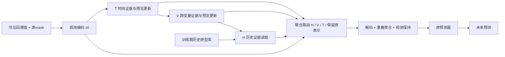

# E23-v31-B 的论文定位与故事线

日期：2026-10-04。当前选定模型：**E23-v31-B**。本文整理现有方法与证据，不改变模型、损失、checkpoint 或评价协议。

**后续证据更新（2026-10-04 12:38）**：已完成 v31-B/T1 的五次独立训练，每个 checkpoint 测试同一批 20 组新缺失位置。v31-B 的 MSE/MAE 为 **0.414918/0.430711**，T1 为 **0.396421/0.421283**；五个种子下均为 T1 更低，两项配对差异的交叉 bootstrap 95% 区间均大于零。本文件后文的原单训练种子、三组测试结果保留为结构探索记录；论文主表应使用新的正式重复结果，不能据旧单次 MAE 主张稳定超过 T1。训练时间均值为 **404.64/751.83 秒**，显存详见[正式报告](ETTh1_P4_E23_v31B_T1_five_seed_twenty_masks_20261004.md)。该证据只覆盖 ETTh1 P4，跨数据集和缺失模式的结论仍待检验。

## 1. 一句话定位

**面向缺失回溯窗口的时序预测，通过结构化证据的协同读取与受约束的联合训练，恢复既遵守观测信息、又能服务下游预测的历史表示。**

全文围绕两个问题组织：

1. 当前局部缺失时，哪些时间、变量和历史记忆证据仍然可用，如何组合它们？
2. 修复器与预测器联合训练时，如何保持历史恢复的约束，避免预测优化伴随整体修复能力退化？

内部版本仍称 E23-v31-B。论文方法暂称 **Evidence-Guided History Recovery（EGHR，证据引导的历史恢复）**，名称用于组织叙事，不据此主张方法或命名独创性。

## 2. 建议标题

中文：**面向缺失回溯窗口时序预测的证据协同历史恢复**。

英文：**Evidence-Guided History Recovery for Forecasting from Incomplete Lookback Windows**。

标题突出任务和方法。当前单轮、单组三专家，不在标题加入深层、多头、递归或因果等未被选定模型实现的能力。

## 3. 任务边界与文献位置

输入为历史窗口中的原可见值与观测掩码，输出为未来序列。缺失发生在回溯输入；本轮 ETTh1 为 96→96。历史修复是服务这一预测任务的前端模块，论文主评价为未来 MSE/MAE，修复误差用于辅助分析。

任务导向插补与插补/预测联合学习已有研究。[TOI-VSF](https://arxiv.org/abs/2411.09928) 针对推理时只有训练变量子集可用的场景，提出服务预测的变量插补及联合学习。我们的实验针对回溯窗口内的时段缺失，两者的缺失单位不同，不能仅凭这一点断言技术新颖。

[CRIB](https://arxiv.org/abs/2509.23494) 从部分观测序列直接学习预测表示，采用信息瓶颈及一致性正则。它给出另一种路线；EGHR 保留受观测约束的恢复接口并读取结构化证据。原文摘要于本次核对，未据摘要进行逐模块优劣判断。

因此，本文应把方法贡献具体到证据组织、顺序条件更新与仲裁、恢复约束的训练作用，并用对照实验支持。不能将“插补为预测服务”本身写成首次提出的思想。

## 4. 引言草稿

多变量时序预测依赖回溯窗口提供近期状态与变化模式。当历史输入存在连续缺失时，预测器能够读取的信息发生变化：同变量的局部上下文可能受损，相关变量也可能缺失，而历史中相似片段与当前状态之间可能存在偏差。因此，一个缺失位置能够使用的证据随变量、时间和观测模式变化。本文研究如何利用这些仍然可见的证据，在保持预测器接口的同时恢复历史输入。

我们将恢复信息组织为三类具有明确来源的证据：当前窗口内同变量的时间上下文、当前窗口内其他变量的局部观测，以及训练期间建立的同变量历史原型。三类来源提供不同的信息补充，其可用性由原始观测和时间限制决定。模型据此构造候选消息与质量特征，并在缺失 patch 上选择需要的恢复更新。

单独优化重建并不能保证最终预测改善。在我们的结构探索中，增强时间编码将 Stage 1 的修复 MSE 从 0.290159 降至 0.243324，但三组缺失测试的预测 MSE 由纯 MSE 对照的 0.409332 变为 0.413701。这个结果说明，在本次实验中，整体重建误差的改善不足以决定预测结构的选择。联合训练还可能使修复器偏离初始恢复解，因此需要同时考虑预测目标与历史恢复约束。

为此，我们提出证据引导的历史恢复模块。模型在 latent 空间中进行一轮 T→V→H 的条件更新，使后续专家基于已有上下文读取证据；随后由包含保留原表示选项的路由器，对三类专家残差进行联合仲裁。解码后的恢复序列保持原观测值与掩码，经原接口送入预测器。训练先学习全局标准化尺度上的恢复，再通过预测损失与均匀修复约束进行联合优化。

当前 ETTh1 P4 的固定验证和三组缺失测试支持该完整方案的选择，修复保留项相对共享 Stage 1、相同预测器初始化的训练对照同时改善预测与修复。后续主实验需检验多数据集、不同缺失模式及多个预测器，并明确报告准确率、训练时间与显存。本段末句是论文证据建设计划，不能在摘要中写成已完成的结论。

## 5. 方法构建：每个模块回答一个问题

| 模块 | 信息来源与操作 | 对应问题 | 表述边界 |
|---|---|---|---|
| 观测编码 | 将原可见 patch 值与 mask 编码为 64 维状态 | 如何区分缺失与已观测输入 | 缺失真值不作为输入 |
| T：多尺度时间证据 | 在当前窗口内同变量的方向/距离分带中选择可见来源 | 该变量自身还有哪些可用上下文 | 窗口内前后上下文均属于已知回溯历史，不读取预测区间 |
| V：局部跨变量证据 | 学习的有向变量先验结合局部可见性与可见位置一致性，选四个其他变量，读取相邻 patch | 哪些相关变量在当前条件下能补充信息 | 学习关系不等于真实因果图 |
| H：历史原型证据 | 从训练期间建立且满足候选结束时间限制的同变量库中选四个历史片段 | 当前上下文不足时，哪些历史模式可参考 | 原 v31-B 中完全缺失目标 patch 无可见 query 时不启用 H |
| 条件更新与路由 | T 更新预览状态，V 读取更新状态，H 读取进一步更新状态；联合分配 H/V/T/保留原表示的权重 | 如何使证据协同，并允许不采用专家残差 | 权重是学习的仲裁量，不是校准的可靠性概率 |
| 恢复接口 | latent 解码为 patch 候选，重叠位置均匀聚合，硬性保持观测，再 patchify | 如何使恢复结果符合输入观测并接入原预测器 | 内部 latent 恢复，预测接口显式还原序列 |
| 两阶段训练 | 全局尺度恢复训练；预测与恢复约束联合训练 | 如何兼顾恢复保真与下游预测 | B 的恢复约束均匀，不含位置收益教师 |

### 结构图

图中箭头表示状态条件与消息依赖。候选缓存基于原观测一次建立；v31-B 的单轮更新不会重新检索 H，也不会把生成值当作真实观测写入库。

## 6. 数学表述建议

记完整监督历史为 $X$，观测掩码为 $M$，未来监督为 $Y$，修复器为 $g_\theta$，预测器为 $f_\phi$。修复器只接收原可见输入、mask 和合规历史库。解码后在观测位置保持输入：

$$
\widehat X=M\odot X_{\mathrm{obs}}+(1-M)\odot\widetilde X_\theta.
$$

公式在训练集全局标准化坐标中理解。query 的局部归一化仍用于模型输入；恢复误差乘回 query_std，以回到全局标准化尺度，不能称为物理原始单位。

设原 patch 表示为 $z_0$，T/V/H 的残差为 $\Delta_T,\Delta_V,\Delta_H$，则单轮条件读取可写为：

$$
u_T=z_0+g_T\Delta_T(z_0),\qquad
u_V=u_T+g_V\Delta_V(u_T),\qquad
\Delta_H=\Delta_H(u_V).
$$

最终仲裁为：

$$
z_*=z_0+\alpha_T\Delta_T(z_0)+\alpha_V\Delta_V(u_T)+\alpha_H\Delta_H(u_V),
$$

其中 $\alpha_0,\alpha_H,\alpha_V,\alpha_T$ 是带可用性限制的 softmax 权重，和为 1；$\alpha_0$ 对应不增加专家残差。$g_T,g_V$ 是专家分数与保留分数之差的 sigmoid。预览状态用于后续证据读取，最终表示从 $z_0$ 联合加权得到，不是直接将三个预览状态逐次当作最终恢复。

Stage 1：

$$
\mathcal L_1=\mathcal L_{\mathrm{rec}}^{\mathrm{global}}+0.1\mathcal L_{\mathrm{retrieval}}.
$$

重建只统计原序列中有效缺失坐标，每个时间/变量坐标一次；按同尺度验证修复 MSE 选 Stage 1 权重。训练中的 specialist exposure 对约 20% 受损 patch 限制可用专家，促使各专家参与独立恢复；对该设计的额外收益需要消融验证。

Stage 2 的 v31-B：

$$
\mathcal L_2=\mathcal L_{\mathrm{forecast}}^{\mathrm{MSE}}
 +0.2\mathcal L_{\mathrm{forecast}}^{\mathrm{MAE}}
 +\lambda(e)\mathcal L_{\mathrm{rec}}^{\mathrm{global}},
\quad
\lambda(e)=\begin{cases}0,&e\leq10\\0.05,&e>10.\end{cases}
$$

恢复约束对缺失坐标均匀加权。两个模块共同优化，预测头架构与接口保持原样，预测头权重正常训练；不能称预测器冻结。每阶段各 100 轮，Stage 2 按固定验证 MAE 选 checkpoint。

## 7. 贡献段落的推荐写法

### 贡献一：结构化证据恢复模块

“我们构建了一个面向缺失回溯窗口的历史恢复模块，将窗口内时间上下文、跨变量局部观测及历史原型组织为可用性受限的专家证据，并采用顺序条件读取与联合残差仲裁生成恢复表示。”

该贡献描述具体实现；其相对已有方法的增益与必要性，需通过同预算模块消融和相关工作对照证明。

### 贡献二：保留历史约束的预测联合训练

“我们在全局标准化尺度上训练历史恢复，并在预测联合优化中加入缺失位置的恢复约束。在共享初始修复器与预测器初始化的对照中，该约束同时改善选定权重的恢复和预测误差。”

这是有控制实验支持的训练设计。混合损失和重建正则本身是通用工具，贡献落在该恢复框架中的作用与证据，不将其包装成新的理论目标。

### 贡献三：机制与系统评价

“我们从恢复误差、专家可用性、预测误差及计算资源多个维度评价该模块，研究修复提升与预测收益之间的关系，并报告不同缺失位置下的稳定性。”

当前可支持 ETTh1 三组位置与实际资源；多数据集、多预测器和多训练 seed 应完成后再写成实验贡献。

## 8. 当前证据支持到哪里

| 论点 | 现有证据 | 当前可写结论 |
|---|---|---|
| 修复保留项有作用 | v31 A/B 共享 Stage 1、相同头初始化；B 相对 A 测试 MSE/MAE 降低 0.817%/0.740% | 本次控制实验有增益；不宣称统计显著 |
| 联合预测优化可能伴随修复退化 | A 的选定 Stage 2 修复 MSE 为 0.536136，B 为 0.425882，Stage 1 为 0.290159 | B 抑制了对照中的修复退化，但没有完全保留 Stage 1 修复水平 |
| 更低修复 MSE 不保证更好预测 | v35 Stage 1 修复 MSE 0.243324；最终预测未超过纯 MSE 对照；v31 C 修复略优于 B，预测略差 | 本次研究存在目标不一致的实例，不能主张一般性定理 |
| 三专家提供不同信息 | 结构来源不同；v12 冻结权重屏蔽每个专家均使指标退步 | v12 支持专家参与；不能冒充 v31-B 从头训练消融 |
| 可接入原预测器 | 原 PatchTST D16/35427 参数、接口一致，恢复器独立 | 实现具备模块化接口；跨预测器泛化待实验 |
| 相对 T1 的表现 | B 三组均值 MSE/MAE 0.406769/0.420725，T1 为 0.402273/0.425508 | B 的 MAE 更低、MSE 仍更高；没有全面胜出 |
| 资源表现 | B 完整训练 402.83 秒，allocated/reserved 1.803/5.479 GiB；T1 643.48 秒，1.779/2.699 GiB | 实际设置下训练更快；没有显存优势或同预算加速结论 |

T1 的 Stage 1 为 batch16/BF16/74 轮、Stage 2 为 batch128/FP32/100 轮；E23 为各阶段 batch128/FP32/100 轮。三个缺失位置 draw 的总体 std 不等于重复训练的方差。E22 多数据集结果属于 E22，不能记为 v31-B 的泛化结果。

## 9. 把故事闭合需要的优先证据

下表是后续证据规划，本次没有启动训练。

| 优先级 | 实验或分析 | 对应审稿问题 |
|---|---|---|
| 1 | v31-B 自身的 H/V/T 冻结屏蔽诊断，并在正式消融中从头训练去除各专家的模型 | 三类来源是否各有必要，结论是否依赖训练后的共适应 |
| 1 | 固定宽度、来源策略、损失与预算，对比并行读取与单轮顺序条件读取 | 协同机制是否比专家并列有效 |
| 1 | 原路由、固定平均、无保留选项；按缺失程度/可用来源分组报告 | 自适应仲裁与保留选项是否解决实际问题 |
| 1 | 已有 v31 A/B 的恢复与预测曲线；再按最终选定配置补多训练 seed | 恢复保留作用是否稳定，变化发生在哪个训练阶段 |
| 2 | 保持恢复方案，在多个原预测器上比较无恢复与有恢复 | 模块化接口是否转化为预测器迁移收益 |
| 2 | 多数据集、缺失率和块长，在相同测试 masks 上比较 | 当前收益是否只出现在 ETTh1 P4 |
| 2 | 按当前选定 v31-B 重新做区域替换响应分析 | 恢复误差与预测收益关系是否在最终模型中成立 |

冻结屏蔽诊断与从头训练消融回答不同问题，报告中分别注明。区域真值替换用于固定模型的预测响应分析；不据此宣称发现真实数据生成过程的因果关系。E23 的修复约束属于提出的方法，同时保持共同预测器架构；主表需透明列出各方法原训练目标，并用方法内受控对照区分目标项的贡献。

## 10. 论文结构与主图建议

1. Introduction：缺失使证据可用性变化；修复误差与预测收益并不总一致；提出证据协同与恢复约束。
2. Problem Formulation：回溯输入缺失、未来预测任务、掩码与可用历史边界、评价空间。
3. Method：观测表示 → T/V/H 证据 → 单轮条件读取和联合仲裁 → 保持观测的恢复接口 → 两阶段训练。
4. Experiments：精度主表、多预测器、缺失设置与训练 seed、资源、控制消融。
5. Analysis：来源使用、修复/预测曲线、最终模型的区域响应。

主图采用第 5 节结构图，区分“原可见数据”“候选证据”“latent 更新”“显式恢复接口”。第二张机制图优先展示 A/B 的训练曲线与区域恢复/预测收益关系；曲线要来自现有日志，数值图不凭叙事绘制。v34/v35/v36 的结构搜索放补充材料，其负结果可作为机制探索，不作为最佳方法组成。

## 11. 摘要草稿：当前证据版本

缺失回溯输入使多变量时序预测中的可用证据随观测模式变化，且整体重建误差的降低未必带来预测收益。本文提出证据引导的历史恢复模块，将窗口内时间上下文、跨变量局部观测和历史原型组织为三类专家证据。模型在 latent 空间中进行单轮条件读取，并通过包含保留原表示选项的路由器组合专家更新；恢复接口保持原观测值及掩码，可接入既有预测器。训练首先在全局标准化尺度上学习恢复，再通过预测损失与历史恢复约束联合优化。在 ETTh1 的固定缺失块场景中，受控实验表明恢复约束同时改善修复和预测，选定模型在三组缺失位置上的平均预测 MSE/MAE 为 0.406769/0.420725。本文进一步分析恢复与预测之间的关系并记录完整训练时间及峰值显存，为后续多数据集和多预测器验证提供方法与实验基础。

摘要为内部草稿，不据单一数据集宣称普遍优越。正式投稿摘要应在证据补齐后压缩并更新。

## 12. 可复核来源

- [v31 原始报告](E23_v31_forecast_sensitive_P4_trial.md)：A/B/C 的结构、目标与受控结果。
- [v31 与 T1 比较 CSV](ETTh1_P4_E23_v31_T1_comparison_2026-10-03.csv)。
- [v12 专家诊断](E23_v12_expert_ablation_2026-10-01.md)：仅代表旧版本的冻结权重诊断。
- [预测位置干预诊断](2026-10-03_forecast_sensitive_recovery_diagnosis.md)：v29/v30，不冒充 v31-B 诊断。
- [v34–v36 汇总](2026-10-04_E23_three_step_improvement_summary.md)。
- 已核对当前共享区与 v31 正式冻结记录的 `iterative.py`、`router.py`、`historical.py`、`temporal.py`、`variable.py` 及选定配置 SHA 一致；正式 B manifest 确认为单轮 `iterative_tv_h_v1`、`uniform_v1` 修复保留与原 `explicit_v1` 接口。

选定版本不含位置收益加权、多头、三轮循环、v34 上下文原型库、v35 点级卷积或 v36 逐位置融合。这些属于已经完成但未晋级的研究分支。
