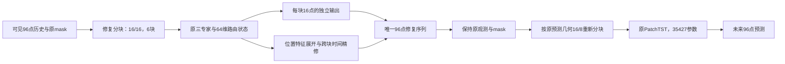

# 非重叠分块与逐点修复头：下一轮设计建议

日期：2026-10-04。状态：已按本设计完成 v43 的 O/N/P 三组开发实验，见[完整结果](ETTh1_P4_E23_v43_nonoverlap_seed502_20261004.md)。修复侧块长等于步长的 N/P 已实现；预测头保持原配置。本轮不替换 v41-slow 开发参考，既有正式实验结论保持原记录。

实施时 O 复用已有 Stage1，只补跑匹配的纯MSE低修复学习率Stage2；N/P各自独立训练100+100轮。源码隔离在 `/home/xyw/paper/.e23-v43-nonoverlap/E23`，82项相关测试与CUDA核对通过。下文保留运行前设计，实际指标以结果报告为准。

## 1. 明确几何设置

| 阶段 | 块长 | 步长 | 96点窗口的块数 | 用途 |
|---|---|---|---|---|
| 新修复器 | 16 | 16 | 6 | 非重叠恢复历史，每个坐标由一个输出位置负责 |
| 原预测器输入 | 16 | 8 | 12，含原末尾padding | 读取同一完整修复序列，预测头配置不变 |

当前修复器16/8先产生重叠候选，再平均为唯一序列。新方案取消修复侧重叠，从源头去掉同一坐标的多个恢复候选与平均操作。

两侧分块几何须解耦。不能直接修改共享 stride 后让预测器也改成16。当前 E23ForecastModel 构造器要求修复器与预测器几何一致，需要将接口改为：修复器输出唯一96点序列，再由适配层按原预测器几何重新 patchify。原 PatchTST 源码、配置与参数量保持一致。

预测输入重新分块时仍有重叠，但同一坐标的数值副本均取自同一修复序列，因此不产生多个独立恢复答案。

## 2. 在非重叠方案上增加的建议

### 2.1 分块编码，逐点解码

保留三专家及64维状态。6个恢复块通过专家与路由得到 `[B,C,6,64]` 表示。

建议分两步验证：

1. 几何版：原线性解码64→16，每块负责自身16点，直接拼接为96点。这一组先判断非重叠几何的实际作用。
2. 增强版：保留上述数值解码作为基底，同时将每块64维状态学习展开为16个位置的点特征，再沿完整96点序列进行时间混合，输出逐点残差。

增强版采用64→16×32的特征展开，reshape为每点32维；结合原可见值、mask、块内位置和原修复值，投影到64维。沿用两层时间残差块，depthwise kernel5、dilation1和3，最终输出一个标量残差。网络在变量间共享权重。

数值分支与特征展开均按真实时间顺序拼接，不做重叠平均。残差输出层零初始化，新增模块初始化隔离RNG，使增强版初始输出与对应非重叠几何版一致。

这一步改善点级表达能力的效果需实验验证；不预先认定逐点特征展开优于原线性解码。

### 2.2 跨越块边界交换上下文

非重叠仅限定输出责任，不限制上下文读取。三专家可以读取相邻时间块、相关变量与历史库；点级时间网络可跨越第15/16、31/32等块边界。

16/16将块数从12降到6，专家的时间分辨率和邻接范围都会变化。实现时需列出原/新参数对应的实际时间跨度，按原时间坐标核查索引与候选结束时间限制。原 radius2在stride8下的16点距离，可对应新radius1；其余无法用整数块精确对齐的偏移应明确记录，不声称只改变了平均操作。

历史原型库不因输出非重叠而必然需要重建。应先核查其与 query 几何的耦合：若能接收新的 query 起始时间而保留原训练库，则保持库来源与密度；若必须重建，应独立记录成员数、来源密度与SHA，不将该变化隐去。

### 2.3 为预测保留局部修复能力

增强版读取完整96点上下文，第一轮只在最近32点的有效缺失位置应用残差，其余缺失位置使用非重叠基底。这个范围继承已做的开发诊断和v41设置，不能称为普适因果重要性。

Stage1仍为全局标准化尺度上的唯一缺失坐标修复MSE + 0.1检索损失；每个真实坐标计一次。

Stage2按用户要求使用纯预测MSE。建议匹配对照统一采用预测器学习率1e-4、修复器1e-5，检验降低修复更新速度的效果。原预测头权重正常训练；预测头结构、超参数和未来输出接口不变。纯MSE与低修复学习率的组合尚未完成匹配实验，不能直接套用旧v41混合损失结果。

未来标签仅用于训练损失和评分。修复前向只读取可见历史、原mask与合规历史库；可见值严格保持，生成值不改写原观测mask。

## 3. 整体流程

## 4. 受控实验顺序

| 组别 | 修复几何 | 修复数值输出 | 主要回答的问题 |
|---|---|---|---|
| 匹配对照 | 16/8 | 当前线性解码、平均与tail32精修 | 统一训练设置下的基准 |
| 非重叠几何版 | 16/16 | 线性解码、直接拼接与匹配tail32精修 | 改变修复分块几何是否有效 |
| 非重叠增强版 | 16/16 | 直接拼接基底、点特征展开与tail32精修 | 非重叠基础上增强逐点信息是否有效 |

两种几何的块数、专家索引和计算量不同，第一项比较不能单独归因于消除重叠。增强版与非重叠几何版的比较用于进一步判断逐点特征展开的作用。若有效，再做等参数量控制。

所有组在运行前固定相同数据、mask、训练预算、预测头初始化、padding规则与训练RNG时点；batch128、100+100轮、FP32，避免同时更改训练目标以外的多个接口细节。

seed502仅作为开发种子。固定验证分别保存MAE选模和MSE选模checkpoint，主版本按验证MAE选择；锁定后使用同一20组测试缺失位置，保留全部结果。新结构有效后再做多训练种子复核。

## 5. 报告与核对

- 预测MSE/MAE：固定验证、20组测试均值与缺失位置变化标准差。
- 修复MSE/MAE：全96点、前64点、最近32点及块边界附近分别报告。
- 完整与阶段训练时间、峰值allocated/reserved GiB、实际参数量与设备。
- 非重叠输出坐标覆盖完整且唯一、观测值保持、隐藏输入不影响前向、padding排除、预测重新分块的重叠副本一致。
- 原预测头源码、配置与初始化身份一致；修复query索引、历史库限制及真实时间覆盖范围正确。

不把消除重叠直接写成性能改善，不仅凭更低整体修复MSE判定成功；最终目标是固定预测头下更好的未来预测。

## 6. 已有依据

- [v36重叠数值加权的结果](E23_v36_overlap_fusion_P4_trial.md)：不是本轮非重叠方案。
- [固定验证区域干预诊断](ETTh1_P4_forecast_sensitive_seed502_20261004.md)。
- [v41结果](ETTh1_P4_E23_v41_repair_drift_seed502_20261004.md)。
- [v42结果](ETTh1_P4_E23_v42_MSE_dual_selection_seed_search_20261004.md)。
