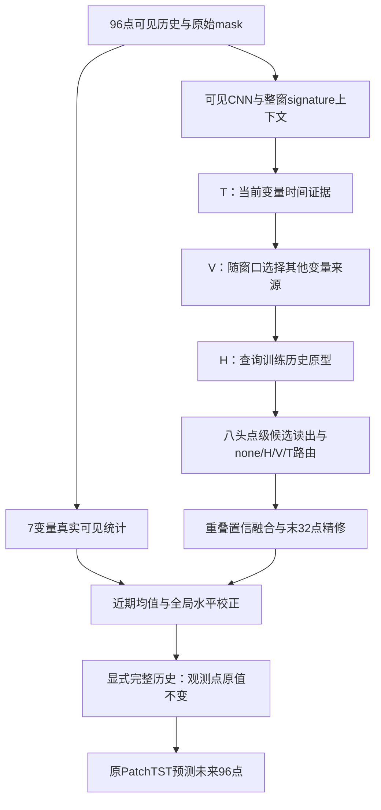

# E23-v79：设计过程、关键模块与实测改进

日期：2026-10-07。本文只整理已有记录，没有训练、重新选模或新增测试；后台E24 Weather不受影响。v79为封存基础模型，本轮材料整理不启动E23迭代队列。

## 1. 先抓住核心设计

我们要解决的是：历史窗口缺失时，如何提取足够可信的历史信息，交给保持不变的预测器。v79先在修复器内形成表示和候选，再显式恢复96点历史，最终由原PatchTST预测未来96点。

它有三条相互配合的设计线：

1. **证据从哪里来**：当前时间T、当前其他变量V、训练历史原型H；单轮条件读取T→V→H。
2. **证据怎样到达每个缺失点**：可见CNN和整窗上下文、八头候选读出、点级路由、重叠置信融合、末32点精修。
3. **恢复的数值尺度怎样可靠**：全局修复MSE训练/选模、稳健局部坐标、近期均值与跨变量全局水平校正。

Stage2完全冻结修复器，把“修复学习”与“预测器学习”分开；这既防止修复表示被预测梯度继续改写，也提供与冻结T1匹配的下游比较。

图示为职责关系；路由的专家名称仍是H/V/T，不意味着有八套完整三专家。模型内的顺序更新也不构成因果识别。

## 2. 设计为何逐步走到这里

### 2.1 最初三专家：先回答信息来源

H补充训练历史形状，V利用同窗变量联系，T利用同变量时间连续性。早期width64的v3固定验证推理消融：全模型MSE0.764770；关闭H/V/T分别变为0.826515/0.831872/0.792099。三类证据在该已训练权重中都有效，V的关闭损失最大。这是v3推理消融，不是v79重训练消融，不能直接当作v79三个专家的贡献排名。

### 2.2 宽度16→64：增加修复表示容量，保持预测器不变

同一早期P4固定测试，宽度16→64使预测MSE0.448187→0.429694、MAE0.439265→0.437349。之后只改Stage2选模政策为验证MAE，v3测试为0.427265/0.434449。前者是容量变化，后者是选模变化；两种收益不能都归给模型结构。它们只有单seed/单组位置，是早期探索结果。

### 2.3 V从全局固定来源变为当前窗口来源

v12保留4个名额，依据当前窗口/patch证据选来源。验证MSE0.763652→0.745448、MAE0.589049→0.588212（相对v11）；其单组测试0.425613/0.431006。作用是让可用来源随缺失位置变化，而非在所有窗口使用相同四变量。H的分组重排v13没有进一步改善，故未继承。

### 2.4 v28解决评分尺度失真

旧v12中，可见std<0.01的缺失坐标只占0.672678%，却贡献窗口归一化平方误差98.991745%；换到训练全局标准化尺度后仅贡献0.286937%。v28改为缺失坐标 `((修复值−真值)×query_std)^2`，按同尺度验证MSE选Stage1，保留0.1检索损失。

同尺度修复MSE从v12的0.368824变为v28的0.305816，降17.08%。本轮训练内部按全局指标选第99轮，按窗口指标则选第26轮，确实出现不同选模。这里同时改了损失形状和尺度，不能拆分两者的独立贡献。

### 2.5 单轮条件读取优于盲目增加重复

v29先用T/V形成当前证据，再由更新后的表示查询H。单轮的三位置预测0.410121/0.423863，三轮0.424405/0.439457。三轮Stage1修复可降至0.255366，但最终预测没有更好；v30大堆叠Stage1修复0.205550也未转成预测优势。最终保留单轮。这不是“重复一定无用”，而是现有重复形式未找到收益。

### 2.6 高缺失下，从patch级仲裁走向可见上下文和点级取舍

v46增加可见CNN；v48增加点级路由；v51增加八头候选读出；v54在同一读出基础上改稳健局部坐标。重要的是：v51单独在当时配方中预测退步，v54坐标处理才使这套读出组合恢复收益。因此八头模块目前有功能解释和组合证据，尚没有证明它在v79中单独一定增益的移除重训练消融。

重叠patch仍用P16/S8，通过confidence融合处理同一点多个输出；最近32点精修补足末端粒度。v49/v50的开发测试也没有每项都同时改善MSE/MAE，不能把所有子模块写成独立单调增益。

### 2.7 近期水平、整窗关系、位置与冻结

近期均值项让模型关注末32点的level；v63去掉此前失败的大统计调制，保留整窗signature注意力；v69加变量×时间位置参数。Stage2全冻结控制显示，保住Stage1信息比继续小步修改修复器更好。以下给出可追溯的历史配对数字。

## 3. 当前v79完整模块和训练配置

输入7变量×96点历史，先只用真实可见历史计算局部统计和上下文；修复后仍接原 PatchTST，未来96点×全部变量。Stage1修复器D64，原预测头D16。前端/修复 P16/S8 重叠，未继承P16/S16或更细粒度的失败分支。

| 部分 | 实现与作用 |
|---|---|
| 可见窗口前端 | `window_cnn_v1`，两层CNN、宽度64、核7/31、膨胀1/2；只读取可见输入 |
| 整窗上下文 | `signature_plain_pos_v3`，无统计调制的两层signature注意力，加变量×时间位置参数；宽度64、特征轴64 heads；属于修复器 |
| 修复坐标 | `robust_local_v1`，稳健局部尺度；修复监督与选模回到全局训练标准化尺度 |
| 专家读取 | 单轮 `iterative_tv_h_v1`，T→V→H条件读取；不是连续三轮修复 |
| T | 当前变量的时间候选，局部半径2，距离带边界2/4/8/16 |
| V | `window_context_topk_v1`，每目标随当前窗口选择4个来源，patch偏移-1/0/+1 |
| H | 仅训练期可见patch构建的在线原型，top4、阈值0.7、`legacy_v1` key政策；无足够可见query时仍可能没有历史证据 |
| 候选读取 | `eight_head_v1`，8个宽度64的点级候选读出；不是8套独立完整H/V/T |
| 点级路由 | `pointwise_v1`，none/H/V/T四类取舍，允许保留原表示 |
| 重叠融合 | `confidence_v1`，学习融合P16/S8多份点级候选，观测值严格保留 |
| 点级精修 | 最近32点 residual refiner，宽度64 |
| 近期均值修正 | 原mean_v1 + `global_level_mean_v2` 分支：49→64→1，新增3265参数，真实可见的7变量整窗/末32点统计，输出有界全局level校正，仅作用末32点缺失坐标 |
| 公共预测头 | 原PatchTST：D16、4 heads、FF128、3层、dropout0.3、P16/S8；35427总参数/35424可训练 |

v79修复器总参数 **424238**，其中 v69为420973，新增global-level分支3265。模型配置 `configs/e24_v79.yaml` 与正式v79逐字相同。

Stage1：100轮、batch128、Adam lr0.001、FP32；global hidden MSE + 0.1 retrieval + recent_mean_v2(level1/trend0)，按固定验证全局修复MSE选权重。**没有 Stage1辅助预测头，也没有v72的长缺失矩结构项。**

Stage2：100轮、batch128、Adam lr1e-4、FP32、原头从seed2023初始化、纯预测MSE、整个修复器冻结；按验证MAE选主checkpoint，同时保存同轨迹MSE次选。ETTh1每阶段6600更新。

## 4. 关键模块的历史收益：有数据，但不夸大证据

以下全部为sr015_bl8、旧20组测试均值，按各版固定验证MAE选权重。除位置参数配对为seed2023，其余为seed502。它们是不同历史实验配方的局部配对，不是把整个v79逐模块拆除后重训练的完整消融。正的下降百分比代表改善。

| 设计变化 | 父版→新版 | MSE父→新 | MSE下降 | MAE父→新 | MAE下降 |
|---|---|---:|---:|---:|---:|
| 可见CNN前端 | E23-v41-slow → E23-v46-front-context | 0.455761 → 0.446929 | 1.94% | 0.453554 → 0.444050 | 2.10% |
| 冻结前端 | E23-v46-front-context → E23-v47-frozen-front | 0.446929 → 0.443177 | 0.84% | 0.444050 → 0.441950 | 0.47% |
| 点级专家路由 | E23-v47-frozen-front → E23-v48-point-router | 0.443177 → 0.438415 | 1.07% | 0.441950 → 0.438458 | 0.79% |
| 稳健局部坐标 | E23-v51-candidate-readout → E23-v54-local-coordinates | 0.452968 → 0.431608 | 4.72% | 0.453161 → 0.435215 | 3.96% |
| 整窗signature注意力 | E23-v58-recent-mean → E23-v63-plain-signature-MAE | 0.428037 → 0.425347 | 0.63% | 0.437745 → 0.432369 | 1.23% |
| 全部冻结修复器 | E23-v63-plain-signature-MAE → E23-v64-retained-frozen-MAE | 0.425347 → 0.417380 | 1.87% | 0.432369 → 0.419302 | 3.02% |
| 变量×时间位置参数 | E23-v65-seed2023-frozen-MAE → E23-v69-seed2023-frozen-MAE | 0.415625 → 0.408509 | 1.71% | 0.417999 → 0.413151 | 1.16% |

- **证据较直接**：全部冻结控制复用了相同Stage1；v54是v51基础上的坐标改动；v69位置参数有相同seed/冻结政策的参考。
- **阶段性证据**：v58→v63包含中间父版/训练路径，不能把全部差值归为signature单模块的因果贡献。
- **尚需补充**：v79本身的CNN、H/V/T、八头读出、置信融合、末32点精修等逐模块移除重训练；不同seed/数据集重现。不能据当前历史轨迹宣称每个模块在所有场景都必要。

## 5. v79相对v69到底新增了什么

只将 `recent_mean_projection: mean_v1` 改为 `global_level_mean_v2`：在原均值校正器旁增加 `Linear(49,64)→GELU→Linear(64,1)`，共3265参数。它不改预测器。

每个变量取6项真实可见统计：整96点均值、末32点均值、最近可见值、整窗可见比例、末32点可见比例、可见query_std。7变量共42项，拼接目标变量7维one-hot，共49项。新分支不读取隐藏真值，也不把粗修复值当真实统计；整窗都无观测时输出新修正0。

新分支输出 `δ=2*tanh(g/2)`，单位是训练全局标准化值；与原均值支路的修正相加，只施加到末32点缺失坐标。再乘 `share=min(32/末32点缺失数,4)` 并除query_std写回局部接口；可见点硬保留。**±2是新分支乘share前的界，不是整个最终修复值或总修正的界。** 最后一层零初始化，构造时隔离RNG，保持父版初始函数与公共头初始化。

设计动机：粗候选在局部相对坐标中可能形状合理，却有近期整体level偏移。其他变量的当前真实可见水平为level提供额外参照。这个解释与模块输入/作用方式一致，但需消融验证，不能仅由最终误差推断因果机制。

### 同配方v69→v79：四场景预测

双方纯MSE、全冻结、原头、seed2023、100轮；旧20组均值。每格MSE/MAE，下降为v79相对v69。

| 起点率/块长 | v69 | v79 | MSE下降 | MAE下降 |
|---|---:|---:|---:|---:|
| 0.10/8 | 0.386839 / 0.400536 | 0.385919 / 0.398839 | 0.24% | 0.42% |
| 0.15/8 | 0.409547 / 0.414068 | 0.405380 / 0.411311 | 1.02% | 0.67% |
| 0.20/8 | 0.477433 / 0.453243 | 0.475542 / 0.449796 | 0.40% | 0.76% |
| 0.10/16 | 0.559487 / 0.500499 | 0.555073 / 0.491735 | 0.79% | 1.75% |

### 同时检查Stage1修复，避免只挑预测收益

| 起点率/块长 | v69全窗验证修复MSE/MAE | v79全窗验证修复MSE/MAE |
|---|---:|---:|
| 0.10/8 | 0.172162 / 0.266436 | 0.169599 / 0.264671 |
| 0.15/8 | 0.242310 / 0.320981 | 0.247287 / 0.324493 |
| 0.20/8 | 0.383579 / 0.402951 | 0.385082 / 0.403593 |
| 0.10/16 | 0.495935 / 0.466956 | 0.504676 / 0.471397 |

v79的预测四场景两指标都改善，但修复MSE只有0.10/8改善，其余三个略退步。因此不能说global-level分支“全面提高修复质量”，更不能只用预测提升证明最近32点已修得更好。

## 6. 与T1的当前完整结论

## 全窗口未来96点预测：旧20组开发测试

| 起点率 / 块长 | v79 MSE / MAE | T1 MSE / MAE | v79是否两项更优 |
|---|---:|---:|---|
| 0.10 / 8 | 0.385919 / 0.398839 | 0.386992 / 0.400414 | 是 |
| 0.15 / 8 | 0.405380 / 0.411311 | 0.408589 / 0.414075 | 是 |
| 0.20 / 8 | 0.475542 / 0.449796 | 0.491737 / 0.456650 | 是 |
| 0.10 / 16 | 0.555073 / 0.491735 | 0.579435 / 0.500068 | 是 |

## 全窗口未来96点预测：新20组确认测试（已公开）

| 起点率 / 块长 | v79 MSE / MAE | T1 MSE / MAE | v79是否两项更优 |
|---|---:|---:|---|
| 0.10 / 8 | 0.389033 / 0.400397 | 0.388936 / 0.401594 | 否；仅 MAE 更优 |
| 0.15 / 8 | 0.407524 / 0.412073 | 0.411845 / 0.415469 | 是 |
| 0.20 / 8 | 0.481826 / 0.452810 | 0.502194 / 0.460352 | 是 |
| 0.10 / 16 | 0.557570 / 0.492074 | 0.582249 / 0.500389 | 是 |

## 全回溯窗口96点修复：固定验证集

| 起点率 / 块长 | v79 MSE / MAE | T1 MSE / MAE | v79是否两项更优 |
|---|---:|---:|---|
| 0.10 / 8 | 0.169599 / 0.264671 | 0.152071 / 0.253714 | 否 |
| 0.15 / 8 | 0.247287 / 0.324493 | 0.241364 / 0.322920 | 否 |
| 0.20 / 8 | 0.385082 / 0.403593 | 0.370375 / 0.398005 | 否 |
| 0.10 / 16 | 0.504676 / 0.471397 | 0.506656 / 0.461008 | 否；仅 MSE 更优 |

## 回溯窗口最近32点修复：固定验证集

| 起点率 / 块长 | v79 MSE / MAE | T1 MSE / MAE | v79是否两项更优 |
|---|---:|---:|---|
| 0.10 / 8 | 0.175469 / 0.273260 | 0.155162 / 0.259676 | 否 |
| 0.15 / 8 | 0.265658 / 0.335775 | 0.247042 / 0.327643 | 否 |
| 0.20 / 8 | 0.417770 / 0.416422 | 0.362806 / 0.399612 | 否 |
| 0.10 / 16 | 0.514318 / 0.490293 | 0.502126 / 0.465944 | 否 |

结论：旧20组预测两指标四场景都优于T1；新20组只有三场景两指标都优于T1，0.10/8预测MSE落后0.0000968363。全窗口修复只有长块场景MSE略优，其余MSE及四场景MAE都落后；最近32点修复四场景的MSE与MAE均落后。不能声称三项评估均全面超过T1。

0.10/8 修复为暂停后读取已有选定权重的补充推理，未训练，参数/记忆/检索状态及 checkpoint 哈希核对通过。其他三场景来自已保存的同口径诊断。

[完整 CSV](./ETTh1_E23_v79_T1_forecast_full_repair_last32_pause_20261007.csv)

## 7. 实验口径与当前证据边界

- ETTh1 96→96、7变量；训练/验证/测试边界0/8640/11520/14400，训练段全局标准化。四个场景0.10/8、0.15/8、0.20/8、0.10/16，允许块重叠；起点率不是最终点缺失率。
- 当前比较双方公共Stage2均纯MSE、全冻结、原头同初始SHA、batch128/FP32、Adam lr1e-4、100轮/6600更新；MAE主选，MSE次选同轨迹另存，不混入主表。
- v79 Stage1 seed2023、100轮/6600更新；T1 Stage1 seed502、作者batch16/BF16/早停预算。不是Stage1优化器预算完全相同的比较，差异披露。
- 旧20组mask seed2026100401..20；新确认20组2026100701..20；两套都已公开。单权重20组位置的std不是训练seed的std；v79没有完整五seed结论。
- 全窗/末32点修复是固定验证诊断，尚缺正式20组测试修复。v79目前并未在预测、全窗修复、末32点修复三项上四场景全面击败T1。
- v79两阶段成本约839–871秒、allocated约4.51–4.67GiB；T1侧含原Stage1缓存成本与新Stage2实测，资源范围见原CSV。完整训练时间包括准备、全部轮次、验证/保存，排除最终测试。
- 近期/变量关系是统计证据，不构成已识别因果关系。oracle替换诊断只读取固定验证真值，不进入训练；不能把oracle预测当模型成绩或理论上界。

## 8. 对外表述与后续补证

目前可以表述：以时间、变量、训练历史三类证据为基础，结合点级仲裁、稳健数值恢复和近期跨变量level校正，形成可接原预测器的缺失历史修复模块；在锁定的纯MSE冻结下游配方中，v79相对匹配v69改善四场景预测均值，且在新位置确认中对T1有三个场景双指标优势。

仍需补证：v79逐模块重训练消融、全/末32点20组测试修复、多训练seed、跨领域数据集。八头、重叠融合、近期精修的职责可以解释，独立贡献应以这些消融判断。E24 Weather正在提供跨领域实验，本材料不读取其运行中结果。

## 9. 证据文件

- `E23_v79_key_module_historical_improvements_20261007.csv`：历史局部配对收益与范围。
- `E23_v79_matched_forecast_improvements_20261007.csv`：v79相对匹配v69/T1的四场景绝对/相对提升。
- `E23_v79_v69_stage1_repair_comparison_20261007.csv`：新增分支前后的修复变化。
- ZIP中的 `FILE_INDEX.csv` 给出每个文件的原始路径、包内位置、大小和SHA256；`PACKAGE_README.md`说明范围和旧路径查验方式。原始记录均保留字节内容，没有为可移植性重写历史manifest。
