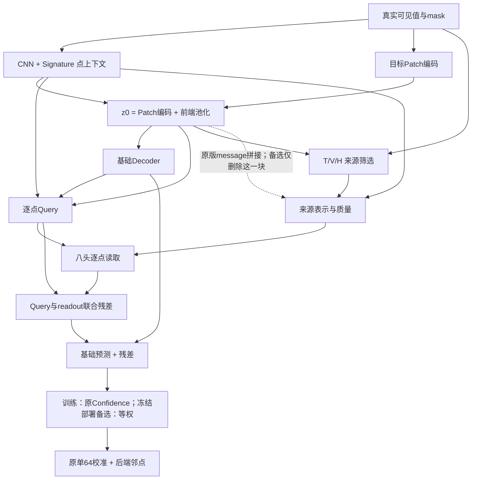

# R3 点级上下文与Patch证据职责分离：最终实验报告

## 结论与版本建议

原R3（H_GLOBAL坐标对齐版）继续作为默认准确性基线，本轮不自动发布新版本。两项简化都有实测代价，未发现可以同时宣称精度提高、候选作用增强、成本明显下降的方案。

1. **Confidence可作为部署精简选项，但不能笼统说没必要。** sr015三seed等权替代最终MSE约+0.254%、MAE约+0.013%；sr020三seed约+1.244%、+0.838%。更高缺失已有可见损失。它预测的是Patch重叠权重，不是三专家选择概率。
2. **候选message中的显式目标z0可以少做一次，作为有轻微精度代价的轻量备选。** 保留原训练期Confidence、冻结后统一等权的严格对照中，删除12288个权重，sr015三seed相对同融合控制测试MSE约+0.773%、MAE约+0.394%；sr020单seed相对控制恢复约2.145% MSE和1.721% MAE。没有展示一致的精度提升。
3. **已训练模型仍使用候选读取向量，但不能因此宣称三专家分别必要或更强。** 保留Query、将readout置零的验证诊断均变差；其影响是条件依赖，不是重训因果贡献。删除目标块后部分seed依赖幅度变小，不能把职责更清楚包装成专家收益更大。

原模型的T/V来源上下文、目标依赖的候选选择/先验、H目标尺度转换和质量计算仍保留。本轮只删message显式目标块，不宣称候选编码完全目标无关或前后端彻底解耦。

校准沿用原单支64：局部卷积、单层 Transformer 和后端邻点机制。校准参数按共同规则重训，完整粗模型冻结；不同时改校准结构。

## 范围与执行修订

基线按用户最新指定为R3，不是原未对齐H的R2。sr015先开发并按预先固定的验证双指标1%规则选型；再固定配置确认sr020。原先已开始的三seed收尾；用户随后要求开发只做单seed，因此最后的sr020消息确认只使用seed2023，训练seed标准差留空。20组mask从来不是20训练seed。

第一阶段冻结同一主干比较learned、uniform、固定正三角位置权重。两种固定方式在sr015均通过，按预先简单程度顺序选uniform，不因position测试更好而改选。

早期编码对照将uniform也用于主干训练，两臂匹配但共同改了训练融合。其数据完整保留为附加对照；验证相对原R3未保性能，而测试差距很小，不能据此证明训练期Confidence必须保留。最终严格匹配实验恢复原训练期Confidence，只改message目标块，冻结后双方同用uniform；修订在新模型测试前登记，不增加其他结构或阈值搜索。

## 第一阶段：同一冻结主干的融合比较

测试先每seed平均20mask，再汇总训练seed；±为训练seed样本标准差。

| 场景 | 训练seed数 | 融合 | 最终MSE | 最终MAE |
|---|---:|---|---:|---:|
| sr015_bl8 | 3 | learned | 0.172952 ± 0.002492 | 0.257154 ± 0.002537 |
| sr015_bl8 | 3 | uniform | 0.173391 ± 0.001700 | 0.257188 ± 0.001402 |
| sr015_bl8 | 3 | position | 0.172748 ± 0.001634 | 0.256825 ± 0.001417 |
| sr020_bl8 | 3 | learned | 0.261637 ± 0.001937 | 0.322525 ± 0.002195 |
| sr020_bl8 | 3 | uniform | 0.264891 ± 0.003859 | 0.325228 ± 0.004885 |

三阶段及逐seed结果全部在R3_responsibility_stage_results.csv，不能只读最终分数判断融合本身。下表给出等权相对learned的变化：

| 场景 | 校准前MSE变化 | 校准前MAE变化 | 校准后MSE变化 | 校准后MAE变化 |
|---|---:|---:|---:|---:|
| sr015_bl8 | +0.299% | +0.177% | +0.254% | +0.013% |
| sr020_bl8 | +0.254% | +0.064% | +1.244% | +0.838% |

校准对差异的响应并非总是掩盖，也可能放大；最终差值包含相同校准训练和MAE选模的响应，不能全部归于原Confidence单独作用。

## 第二阶段：只删除message显式目标z0

CONTROL和MESSAGE_ONLY在主干训练时均保留原Confidence；冻结后的融合均为uniform。双方Query、CNN、Signature、基础预测、候选规则/预算/源上下文和读取结构相同。

| 场景 | 训练seed数 | 组别 | 最终测试MSE | 最终测试MAE |
|---|---:|---|---:|---:|
| sr015_bl8 | 3 | CONTROL | 0.173391 ± 0.001700 | 0.257188 ± 0.001402 |
| sr015_bl8 | 3 | MESSAGE_ONLY | 0.174732 ± 0.001474 | 0.258201 ± 0.000474 |
| sr020_bl8 | 1 | CONTROL | 0.268180 | 0.330569 |
| sr020_bl8 | 1 | MESSAGE_ONLY | 0.262428 | 0.324880 |

两场景验证均通过既定1%规则，测试未用于改选。sr020是单seed开发证据，不能称跨训练seed稳定。

与原R3（learned部署）直接比较时也必须使用同一seed口径：

| 场景/口径 | 原R3 MSE/MAE | 简化组合 MSE/MAE |
|---|---|---|
| sr015，三seed均值 | 0.172952/0.257154 | 0.174732/0.258201 |
| sr020，seed2023 | 0.261606/0.324353 | 0.262428/0.324880 |

简化组合相对原R3的sr015测试MSE约+1.03%，sr020单seed约+0.31%。即使通过验证选型门槛，也不能表述为测试严格无损。默认保留R3，轻量方案单独归档；本轮不按测试重新挑融合、阈值或seed。

## 三阶段解释与候选证据

- base：同一联合训练模型的decoder(z0)，按该模型融合回放；另报统一uniform基础输出作为参考。它没有单独的独立优化目标。
- candidate：加入Query/readout联合残差，并完成重叠融合之后。
- final：原结构校准之后。
- 三个阶段均来自共同协议选定的同一模型，不另挑“校准前最好”的checkpoint。
- base到candidate的下降还包含Query直达联合输出头的能力，不能全部称候选源贡献，条件收益不相加为贡献百分比。

删除message目标块后，三个sr015 seed和sr020 seed2023的验证中，置零readout均使最终MSE/MAE变差。该诊断没有重训模型，也改变联合头中的输入统计，因此只证明条件依赖，不证明T/V/H分别不可替代、统计显著或优于容量匹配的强上下文模型。

## 参数、延迟、显存与训练成本

| 场景/口径 | 组别 | 有效推理参数 | 完整推理p50均值(ms) |
|---|---|---:|---:|
| sr015_bl8，3 seed | CONTROL | 350367 | 17.173 |
| sr015_bl8，3 seed | MESSAGE_ONLY | 338079 | 17.019 |
| sr020_bl8，1 seed | CONTROL | 350367 | 17.031 |
| sr020_bl8，1 seed | MESSAGE_ONLY | 338079 | 16.901 |

消息删改减少12288个权重（相对等权控制约3.51%）；加上部署移除Confidence共比原R3少15169个有效推理参数（约4.29%）。这里的Confidence仍在训练期使用，不能把训练架构写成完全无此模块。两个消融差值不相加为精度贡献。

NN参数下降不等于同比延迟下降。严格消息对照的p50仅约快0.8%–0.9%，不宣称显著加速；实测峰值显存未展示一致下降。计时全部同一物理RTX5090 GPU0、batch128，5预热25次同步，排除数据加载，逐次时间原JSON保留。

R3_responsibility_models_and_costs.csv同时提供分配/有效参数、主干及校准训练峰值allocated/reserved GiB、训练循环耗时、设备与PyTorch版本、checkpoint地址及SHA。训练循环含各轮验证及保存，但不含全部准备阶段；不能冒充完整端到端墙钟时间，共用主干不能重复计作新增成本。reserved包含缓存。模块分配参数在R3_responsibility_parameter_modules.csv，candidate_condition直接参数和core之外检索encoder单列，避免漏计。

## 改动前后信息流

图中的来源筛选和质量仍有目标条件，来源上下文仍共享前端。该图是代码审计后的边界说明，不代替代码核对，也不宣称所有模块互斥。

## 复现入口与核验

- 版本与源码基线：R3_model_identity.json、2026-10-28_R3_version_definition.md。
- 完整逐项代码审计、训练探索/exposure、固定融合定义、选模规则：2026-10-28_R3_responsibility_separation_audit_design.md。
- 严格匹配边界修订：2026-10-28_R3_message_conditioning_matched_amendment.md。
- 主表：R3_responsibility_summary.csv；逐seed三阶段：R3_responsibility_stage_results.csv；成本与权重：R3_responsibility_models_and_costs.csv。
- 第一期与sr020融合核验：两个输出目录phase_one_audit.json。
- 消息训练输入/同epoch库/完整冻结：r3_message_conditioning_matched_20261028/matched_training_audit_progress.json。
- 两场景阶段结果/20位置/同GPU计时/权重及源哈希：同目录matched_results_audit.json。
- 代码：同目录implementation/matched_worker.py及message_without_target.py；training_source_manifest.json从正式训练起未改。控制组测试只在权重、库和来源匹配后复用。
- 单seed新约定：R3_experiment_policy.md；本轮不再追加训练或预测Stage2。

已有两个场景的测试此前被查看过，属于探索性结果；不宣称盲测、全数据集普适性、三专家分别必要或统计显著。后续正式对比再补种子，按用户新约定不在开发阶段自动补。
